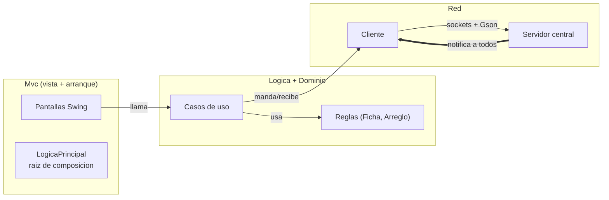
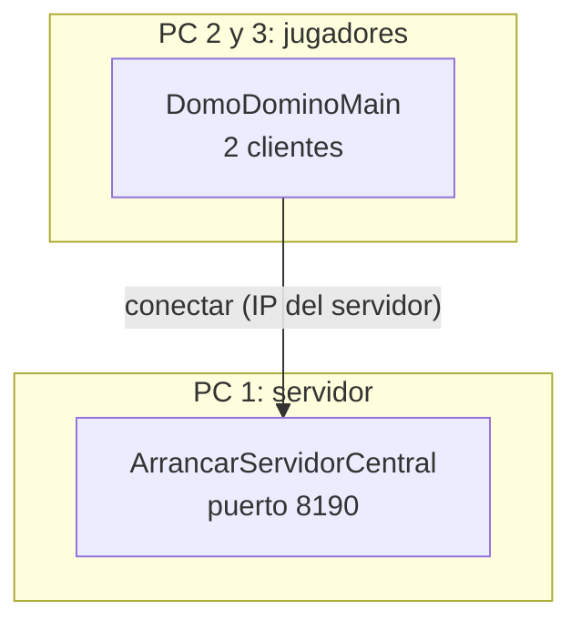
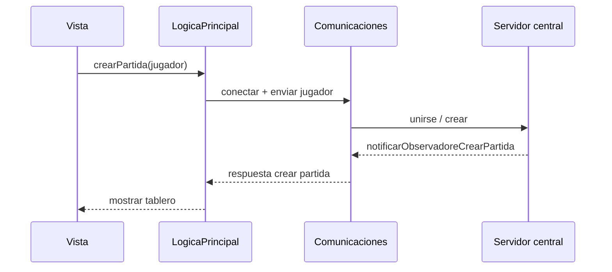
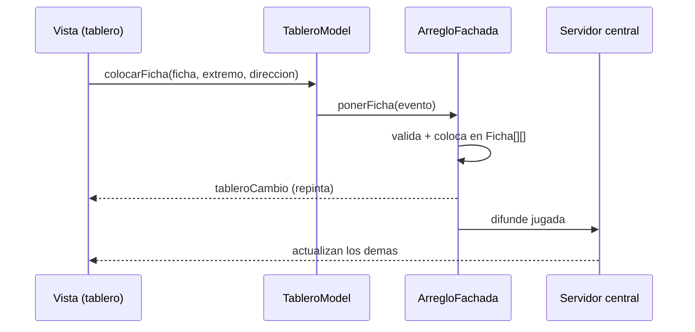

# DomoDomino — Dominó multijugador en Java (P2P centralizado)

Juego de dominó en red: cada dispositivo es cliente y servidor a la vez. Un servidor central empareja, reparte el estado y avisa a todos cuando alguien juega; cada cliente valida y pinta su tablero. Patrones: Fachada, Mediador, Observer con eventos tipados, DTO y Singleton donde toca.

## Módulos

| Módulo | Qué contiene |
| --- | --- |
| `DomoDominoDominio` | Reglas puras: `Ficha`, `Arreglo`, `Pozo`, `GestorTurnos`. Sin red, sin UI. |
| `DomoDominoLogica` | Casos de uso (`Logica*`, `ArregloFachada`). No conoce la vista: compila sin Mvc. |
| `DomoDominoMvc` | Pantallas Swing, `LogicaPrincipal` (raíz de composición) y `DomoDominoMain`. |
| `DomoDominoUtileria` | DTOs y eventos que viajan por la red (`eventos/`, `dtos/`). |
| `DomoDominoCliente` / `ServerInterno` | Red del jugador (sockets + Gson). |
| `DomoDominoServerCentral*` | Servidor de partidas: empareja, reparte y notifica a todos. |





## Cómo correrlo

Requisitos: JDK 21, Maven, los 2+ equipos en la misma red.

```bash
# 1. Servidor central (puerto 8190, imprime su IP al arrancar)
mvn -pl DomoDominoServerCentralServidor -am install -DskipTests
# correr ArrancarServidorCentral

# 2. Cada jugador abre el juego (apunta a la IP del servidor)
# DomoDominoMain en DomoDominoMvc
```

Ojo: la IP del servidor está fija en el código (`LogicaCrearPartida`, `192.168.100.11:8190`). Cámbiala a la IP que imprime el servidor. Mongo (`DomoDominoDominio/conexion`) está preparado pero el flujo actual no lo usa.

## Protocolo (eventos)

Todo lo que cruza la red es un DTO en `eventos/` + callbacks con nombre de intención (`IEventoPonerFicha`, `IEventoRegresar`, `IEventoTableroCambio`...). Nada de `actualizar()` ciego.





## Regla del tablero

Matriz de `Ficha` (no números): `null` = vacío. Cada ficha ocupa 2 celdas (1 si es mula). Solo abre una mula al centro; los extremos mandan qué encaja. Ver `ArregloFachada` y `ArregloTest`.

## Estado

En reestructura (`reestructuracion`): tablero con entidades, Lógica sin dependencia a Vista, eventos con nombre, 8 tests verdes. Pendiente: exportar diagramas draw.io y gif de 2 clientes.
